  <picture>
    <source media="(prefers-color-scheme: dark)" srcset="./dark.svg">
    <source media="(prefers-color-scheme: light)" srcset="./light.svg">
    
  </picture>

<h1 align="center">Hi, I'm Manuri Pabara 👋</h1>

  <strong>IT Undergraduate | Software Engineering</strong> 
  Katubedda, Moratuwa, Sri Lanka

  Interested in building software, exploring technologies, and continuously improving my engineering skills.

---

## 👩‍💻 About me

- 🎓 IT Undergraduate at the University of Moratuwa.
- 💻 Interested in software engineering and full-stack application development.
- 🌱 Exploring technologies across programming, web development, databases, cloud computing, and DevOps.
- 📍 Based in Katubedda, Moratuwa, Sri Lanka.

## 🛠️ Technologies & tools

**Programming languages**

**Frontend**

**Backend**

**Databases**

**Tools, cloud & practices**

## 🚀 Featured projects

### [Caf-O-](https://github.com/Manuri2003/Caf-O-)
A responsive, single-page marketing website for a fictional Sri Lankan coffee house chain, built using plain HTML, CSS, and JavaScript without frameworks. It includes a hero banner, an about section, and additional landing-page content.

**Technologies:** HTML · CSS · JavaScript

### [Courier Parcel Management System](https://github.com/Manuri2003/Courier-parcel-management-system)
A command-line interface (CLI)-based courier parcel management system.

**Repository:** [Courier-parcel-management-system](https://github.com/Manuri2003/Courier-parcel-management-system)

### [OmniSketch](https://github.com/Manuri2003/Omni-Sketch-V6-final)
Explore the project and its implementation in the repository.

### [SplitWise](https://github.com/Manuri2003/SpliteWise)
Explore the project and its implementation in the repository.

---

## 🤝 Connect with me

- **GitHub:** [@Manuri2003](https://github.com/Manuri2003)
- **LinkedIn:** `ADD_YOUR_LINKEDIN_PROFILE_URL`

---

  <i>Always learning, building, and exploring new technologies.</i>

